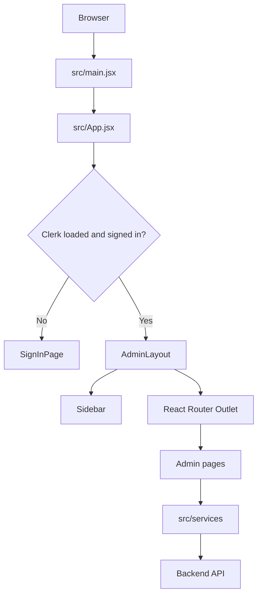
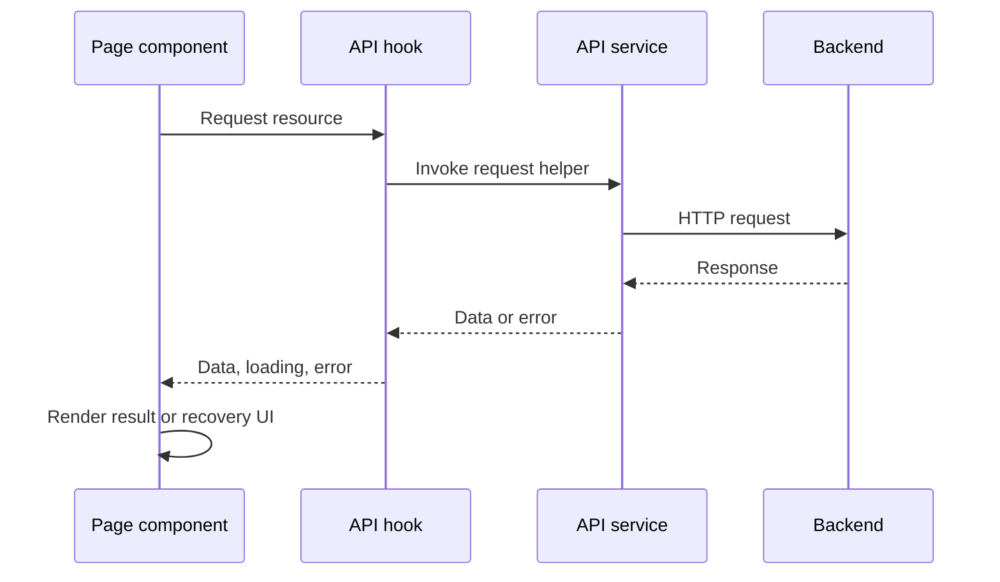
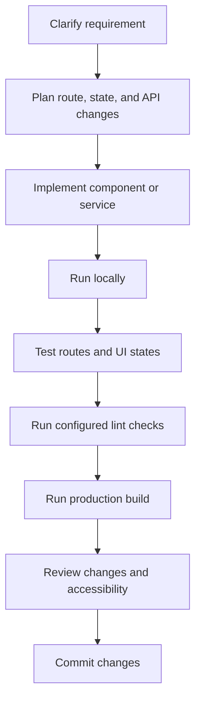

<p align="center">
  
</p>

# Project Management System Admin Panel

## Full-Stack Project Management System: PMS

<h1 align="center">Orbit Admin — Frontend</h1>

<p align="center">A React administration console for the Project Management platform.</p>

<p align="center">
  
  
  
  
  
</p>

---

## Table of Contents

- [Overview](#overview)
- [Features](#features)
- [Technology Stack](#technology-stack)
- [Architecture](#architecture)
- [Project Structure](#project-structure)
- [Prerequisites](#prerequisites)
- [Getting Started](#getting-started)
- [Environment Variables](#environment-variables)
- [Scripts](#scripts)
- [Routes](#routes)
- [Authentication and Authorization](#authentication-and-authorization)
- [API Integration](#api-integration)
- [UI Conventions](#ui-conventions)
- [Development Workflow](#development-workflow)
- [Testing Checklist](#testing-checklist)
- [Security Practices](#security-practices)
- [Troubleshooting](#troubleshooting)
- [Potential Improvements](#potential-improvements)
- [Related Applications](#related-applications)
- [References](#references)
- [Final Learning Objective](#final-learning-objective)

## Overview

Orbit Admin is the administrative frontend for the **Project Management** application. It provides an interface for working with platform resources such as users, workspaces, projects, tasks, comments, and administrative data.

The frontend uses React and Vite. React Router manages client-side navigation, Clerk provides browser authentication and profile UI, Tailwind CSS is used for styling, and Lucide React supplies icons. API utilities are organized in `src/services/`.

The admin app is maintained separately from the main user-facing frontend in `../client` and the backend in `../server`.

> **Scope:** This README documents the `admin/` frontend. Backend behavior, database operations, endpoint contracts, deployment infrastructure, and server-side authorization should be verified in their respective files.

---

# 👨‍💻 About Me

Hi, I'm **Satinder Singh Sall**, a Full-Stack Developer, AI Enthusiast, and MCA student passionate about building scalable digital products, intelligent software systems, and meaningful user experiences.

My journey spans across **Web Development, Mobile Applications, Artificial Intelligence, Cloud Technologies, and Creative Writing**. I enjoy transforming ideas into production-ready solutions using modern technologies while continuously exploring emerging fields like Machine Learning, Computer Vision, and Automation.

Currently, I'm pursuing my **Master of Computer Applications (MCA)** while actively developing full-stack applications, AI-powered solutions, and open-source learning resources. My work focuses on creating software that is not only functional but also scalable, maintainable, and impactful.

## 🚀 What I'm Building

- 🤖 AI-Powered Attendance System using Face Recognition & Voice Biometrics
- 🌐 Modern Full-Stack Web Applications
- 📱 Cross-Platform Mobile Applications
- 🎮 Exploring Game Development & Interactive Experiences
- 📚 Open-Source Learning Roadmaps and Technical Resources
- ✍️ Satinder Poetry — A platform for original poetry, essays, and creative writing

## 🛠️ Core Technologies

**Frontend:** React, Next.js, TypeScript, Tailwind CSS
**Backend:** Node.js, Express.js, REST APIs
**Databases:** MongoDB, PostgreSQL, MySQL, Firebase, Supabase
**DevOps & Cloud:** Docker, GitHub Actions, Vercel, Render
**Programming:** Python, Java, JavaScript, C++, C#, Kotlin
**AI / ML:** Python, Computer Vision, Face Recognition, Automation
**Mobile Apps:** High-Performance Android, iOS, Cross-Platform & Native Development

## 🌍 Connect With Me

🌐 Portfolio: https://satinder-portfolio.vercel.app

💻 GitHub: https://github.com/SatinderSinghSall

💼 LinkedIn: https://www.linkedin.com/in/satinder-singh-sall-b62049204/

🎥 YouTube: https://www.youtube.com/@satindersinghsall.3841

✍️ Satinder Poetry: https://satinderpoetry.com

🤖 AI Attendance Project: https://ai-attendance-app-satinder.vercel.app/

---

> _"I believe great software is built at the intersection of engineering excellence, continuous learning, creativity, and real-world problem solving."_

⭐ Always learning. Always building. Always improving.

---

## Features

- Dedicated administrator sign-in route.
- Protected routes and an authentication-loading state.
- Dashboard and resource-management pages.
- User, workspace, project, task, and comment pages.
- Data explorer page.
- Administrator account page with profile and session information.
- Responsive sidebar with collapse and mobile-navigation behavior.
- Profile menu with account navigation and sign-out action.
- Shared application shell with route-based title and scrollable content.
- Centralized API utilities and reusable API hook.

The presence of a page does not guarantee every CRUD operation is implemented. Confirm available actions in the current page and backend source.

## Technology Stack

| Technology                                                     | Purpose                                  |
| -------------------------------------------------------------- | ---------------------------------------- |
| [React](https://react.dev/)                                    | Component-based user interface           |
| [Vite](https://vite.dev/)                                      | Development server and production build  |
| [React Router](https://reactrouter.com/)                       | Client-side routes and nested layouts    |
| [Clerk](https://clerk.com/docs)                                | Authentication and user profile UI       |
| [Tailwind CSS](https://tailwindcss.com/docs)                   | Utility-first styling                    |
| [Lucide React](https://lucide.dev/guide/packages/lucide-react) | Interface icons                          |
| JavaScript / JSX                                               | Application source                       |
| `src/services/`                                                | API request utilities and reusable hooks |

Installed dependency versions in `package.json` and `package-lock.json` are authoritative.

## Architecture



### Component responsibilities

- **`src/main.jsx`** — application entry point and provider setup.
- **`src/App.jsx`** — sign-in route, protected route wrapper, page routes, and fallback redirect.
- **`src/layouts/AdminLayout.jsx`** — shared sidebar/header shell, page title, scroll container, and nested `<Outlet />`.
- **`src/components/Sidebar.jsx`** — navigation groups, mobile overlay, collapse control, profile menu, and sign-out confirmation.
- **`src/pages/`** — individual administration screens.
- **`src/services/adminApi.js`** — shared API request utilities.
- **`src/services/useAdminApi.js`** — reusable API hook.

### Navigation flow

```mermaid
flowchart TD
    Start[Open admin frontend] --> Loaded{Clerk initialized?}
    Loaded -->|No| Wait[Show loading state]
    Loaded -->|Yes| Signed{Signed in?}
    Signed -->|No| Login[/admin/sign-in]
    Signed -->|Yes| Home[/]
    Home --> Users[/users]
    Home --> Workspaces[/workspaces]
    Home --> Projects[/projects]
    Home --> Tasks[/tasks]
    Home --> Comments[/comments]
    Home --> Database[/database]
    Home --> Account[/account]
```

## Project Structure

```text
admin/
├── public/
│   ├── favicon.svg
│   └── icons.svg
├── src/
│   ├── assets/
│   │   ├── hero.png
│   │   ├── react.svg
│   │   └── vite.svg
│   ├── components/
│   │   └── Sidebar.jsx
│   ├── layouts/
│   │   └── AdminLayout.jsx
│   ├── pages/
│   │   ├── AdministratorAccount.jsx
│   │   ├── Comments.jsx
│   │   ├── Dashboard.jsx
│   │   ├── DatabaseExplorer.jsx
│   │   ├── Projects.jsx
│   │   ├── SignInPage.jsx
│   │   ├── Tasks.jsx
│   │   ├── Users.jsx
│   │   └── Workspaces.jsx
│   ├── services/
│   │   ├── adminApi.js
│   │   └── useAdminApi.js
│   ├── App.css
│   ├── App.jsx
│   ├── index.css
│   └── main.jsx
├── .gitignore
├── eslint.config.js
├── index.html
├── package.json
├── package-lock.json
├── README.md
└── vite.config.js
```

## Prerequisites

- Node.js compatible with the Vite version in `package.json` (a supported LTS release is recommended).
- npm, included with Node.js.
- Clerk application configuration if required by the provider setup.
- A running backend API for pages that request server data.

Check your installation:

```bash
node --version
npm --version
```

## Getting Started

### 1. Open the admin directory

From the repository root:

```bash
cd admin
```

### 2. Install dependencies

```bash
npm ci
```

Use `npm install` when intentionally changing dependencies or updating the lockfile.

### 3. Configure the environment

Create `admin/.env` if the application expects environment variables. Check `src/main.jsx`, `src/services/adminApi.js`, and `src/services/useAdminApi.js` to confirm the exact variable names. See [Environment Variables](#environment-variables).

### 4. Start the development server

```bash
npm run dev
```

Open the URL printed by Vite. The port can vary if the default port is already occupied; use the URL shown in your terminal.

### 5. Sign in

Use the configured Clerk sign-in flow. Once authentication has loaded, protected admin routes should render.

## Environment Variables

Vite exposes client-side variables prefixed with `VITE_`. Values bundled into the frontend are visible to users, so **never place secrets in frontend environment variables**.

The exact names depend on the current source. Typical settings include:

| Setting               | Purpose                          | Verify in                                                    |
| --------------------- | -------------------------------- | ------------------------------------------------------------ |
| Clerk publishable key | Initializes Clerk in the browser | `src/main.jsx` and provider setup                            |
| API base URL          | Selects the backend origin       | `src/services/adminApi.js` and `src/services/useAdminApi.js` |

Example template only; use the variable names actually referenced by the application:

```dotenv
# Example placeholders: confirm names in your source.
VITE_CLERK_PUBLISHABLE_KEY=your_clerk_publishable_key
VITE_API_BASE_URL=http://localhost:YOUR_BACKEND_PORT
```

Never expose a Clerk secret key, database credential, private API key, or signing secret in the frontend. Keep server-side secrets in the backend environment. Do not commit local `.env` files. Restart Vite after changing environment variables.

## Scripts

Run scripts from `admin/`.

| Command           | Purpose                               |
| ----------------- | ------------------------------------- |
| `npm run dev`     | Start the development server          |
| `npm run build`   | Build the production bundle           |
| `npm run preview` | Preview the production build locally  |
| `npm run lint`    | Run ESLint, if this script is defined |

The scripts in `package.json` are authoritative. If a command is not defined there, use the available scripts instead.

Check the production build locally:

```bash
npm run build
npm run preview
```

A successful build confirms that a bundle can be produced; it does not verify API connectivity, authentication configuration, or backend authorization.

## Routes

The current route definitions in `src/App.jsx` include:

| Path             | Page                       | Access               |
| ---------------- | -------------------------- | -------------------- |
| `/admin/sign-in` | `SignInPage`               | Public sign-in route |
| `/`              | `Dashboard`                | Protected            |
| `/users`         | `UsersPage`                | Protected            |
| `/workspaces`    | `WorkspacesPage`           | Protected            |
| `/projects`      | `ProjectsPage`             | Protected            |
| `/tasks`         | `TasksPage`                | Protected            |
| `/comments`      | `CommentsPage`             | Protected            |
| `/database`      | `DatabaseExplorerPage`     | Protected            |
| `/account`       | `AdministratorAccountPage` | Protected            |
| `*`              | Redirect to `/`            | Fallback             |

The protected wrapper checks Clerk's loading and signed-in state. Signed-out users are redirected to `/admin/sign-in`. `AdminLayout` renders nested pages through React Router's `<Outlet />`.

### Adding a page

1. Create a component in `src/pages/`.
2. Import it into `src/App.jsx`.
3. Add a route inside the protected route group.
4. Add a sidebar item in `src/components/Sidebar.jsx` if it should appear in navigation.
5. Add the page title to `pageNames` in `src/layouts/AdminLayout.jsx`.
6. Test direct URL access, sidebar navigation, mobile behavior, and refresh.

Example:

```jsx
<Route path="/reports" element={<ReportsPage />} />
```

Place it inside the protected route group if it should use the admin layout and authentication guard.

## Authentication and Authorization

Clerk manages the browser authentication session. The frontend route wrapper uses the session state to choose between the sign-in redirect, loading UI, and protected layout.

The frontend includes a dedicated sign-in route, an authentication-loading state, a redirect for signed-out visitors, and a profile menu with account and sign-out actions.

### Authentication is not authorization

A signed-in user is not necessarily an administrator. Client-side route protection improves navigation and user experience, but it is not a security boundary.

For production:

- Verify session tokens on the backend.
- Check administrator permissions on every privileged API operation.
- Deny access by default when authorization checks fail.
- Never rely only on hidden buttons, React route guards, or client-side role values.
- Avoid logging tokens, session identifiers, or sensitive personal data.

## API Integration

API utilities are grouped under `src/services/`. Keep request construction, base URL handling, headers, response parsing, and shared error behavior centralized when practical.



Recommended practices:

- Handle loading, success, empty, and error states explicitly.
- Check HTTP status codes; `fetch()` does not reject only because the server returns a 4xx or 5xx response.
- Validate API responses at trust boundaries.
- Cancel or ignore obsolete requests when appropriate.
- Avoid sending credentials to untrusted origins.
- Keep secrets and server-only operations out of the browser bundle.

## UI Conventions

The shared shell is implemented in `src/layouts/AdminLayout.jsx`; sidebar behavior is implemented in `src/components/Sidebar.jsx`.

The current layout includes a collapsible sidebar, mobile navigation overlay, shared header, route-based page title, main scrolling region, Tailwind utility classes, and Lucide icons.

When modifying the layout, test desktop and mobile widths. Pay special attention to `position: fixed`, `z-index`, overflow, and overlays because these can intercept clicks on menu items.

Accessibility checklist:

- Give icon-only buttons accessible names.
- Preserve visible keyboard focus indicators.
- Use buttons for actions and links for navigation.
- Keep heading levels logical.
- Associate form labels with inputs.
- Do not rely on color alone to communicate status.
- Provide useful loading and error feedback.

## Development Workflow



Before submitting changes:

1. Keep changes scoped to the relevant page, component, or service.
2. Follow existing naming and styling conventions.
3. Test direct routes and in-app navigation.
4. Verify loading, empty, error, and success states.
5. Inspect browser console and Network panel for errors.
6. Run configured lint and build scripts.
7. Ensure no credentials or local environment files are committed.

## Testing Checklist

Use test tools that are actually configured in `package.json`. If a test runner is added later, document its command and organize tests by feature or layer.

### Manual checks

- [ ] `npm run dev` starts successfully.
- [ ] Clerk initializes without console errors.
- [ ] Signed-out users are redirected to `/admin/sign-in`.
- [ ] Signed-in users can open protected routes.
- [ ] `/account` opens directly and through the sidebar profile menu.
- [ ] Unknown paths follow the configured fallback.
- [ ] Sidebar collapse and mobile navigation work.
- [ ] Profile menu and sign-out work.
- [ ] API pages show loading, empty, and error states.
- [ ] Requests use the expected backend URL.
- [ ] `npm run build` completes successfully.
- [ ] Backend rejects privileged requests from unauthorized users.

### Suggested automated test layers

| Layer                | Focus                                                   |
| -------------------- | ------------------------------------------------------- |
| Component tests      | Rendering and user interactions                         |
| Route tests          | Protected routes, redirects, outlet rendering, fallback |
| Service tests        | Request construction, parsing, error handling           |
| Integration tests    | Page behavior with test or mocked API responses         |
| End-to-end tests     | Sign-in, navigation, critical admin tasks, sign-out     |
| Accessibility checks | Keyboard use, accessible names, labels, focus           |

## Security Practices

- Never expose Clerk secret keys or database credentials in `VITE_*` variables.
- Treat browser input and API responses as untrusted.
- Enforce permissions on the backend for every privileged endpoint.
- Validate input on the server even when client-side validation exists.
- Avoid rendering untrusted HTML.
- Use HTTPS in production.
- Keep dependencies updated and review security advisories.
- Separate development, staging, and production credentials.
- Redact sensitive information from logs and user-facing errors.
- Consider rate limiting and audit logging for sensitive server operations.

## Troubleshooting

### Blank page

1. Open browser developer tools and inspect the Console.
2. Look for failed imports, JSX errors, or runtime exceptions.
3. Verify the component export and import path.
4. Confirm the route is inside the protected group and `AdminLayout` renders `<Outlet />`.

### Sidebar click does not navigate

1. Confirm the route exists in `src/App.jsx`.
2. Verify the click handler calls the expected navigation function, or use a React Router `<Link>`.
3. Inspect whether an overlay or positioned element intercepts pointer events.
4. Watch the URL after clicking.
5. Test the route directly in the address bar while signed in.

### Unexpected sign-in redirect

- Verify Clerk provider initialization and configuration.
- Check the browser console for Clerk errors.
- Confirm the sign-in route and local application URL.
- Inspect the protected-route logic.

### API requests fail

- Confirm the backend is running.
- Check the API base URL and port.
- Inspect the Network panel for URL, HTTP status, CORS errors, and response body.
- Check server logs and authorization rules.
- Verify environment variable names against the source, then restart Vite.

### Dependency or build errors

```bash
npm ci
npm run build
```

Read the first meaningful terminal error and verify Node.js compatibility with the project's Vite version.

## Potential Improvements

These are suggestions for future work, not claims that the capabilities already exist:

- Add component, route, service, and end-to-end tests.
- Document exact environment variable names and the backend's local port.
- Add consistent error boundaries and user-friendly API errors.
- Add typed API contracts or runtime response validation.
- Add route-level loading states where useful.
- Add accessibility, dependency, and secret scanning to CI.
- Document administrator roles and backend endpoint permissions.
- Add deployment instructions for the chosen hosting platform.
- Add request correlation and structured server logging for production debugging.

## Related Applications

| Directory | Responsibility                                |
| --------- | --------------------------------------------- |
| `admin/`  | Administrative frontend described here        |
| `client/` | Main user-facing project management frontend  |
| `server/` | Backend API and server-side application logic |
| `doc/`    | Project setup documentation                   |

Run each application from its own directory and configure its environment independently. The frontend and backend may use different environment variables, ports, and authentication responsibilities.

## References

- [React documentation](https://react.dev/)
- [Vite documentation](https://vite.dev/guide/)
- [React Router documentation](https://reactrouter.com/)
- [Clerk documentation](https://clerk.com/docs)
- [Tailwind CSS documentation](https://tailwindcss.com/docs)
- [Lucide React documentation](https://lucide.dev/guide/packages/lucide-react)
- [Vite environment variables and modes](https://vite.dev/guide/env-and-mode)
- [OWASP Cheat Sheet Series](https://cheatsheetseries.owasp.org/)
- [OWASP Authorization Cheat Sheet](https://cheatsheetseries.owasp.org/cheatsheets/Authorization_Cheat_Sheet.html)

## Final Learning Objective

The goal of maintaining this frontend is to move beyond simply rendering pages and to reliably **understand, build, debug, test, measure, optimize, secure, and architect** a maintainable administrative interface.

In practical engineering terms, mastery means being able to explain why the application is structured as it is, verify its behavior with tests, diagnose failures systematically, and make changes without weakening accessibility, performance, or security.
